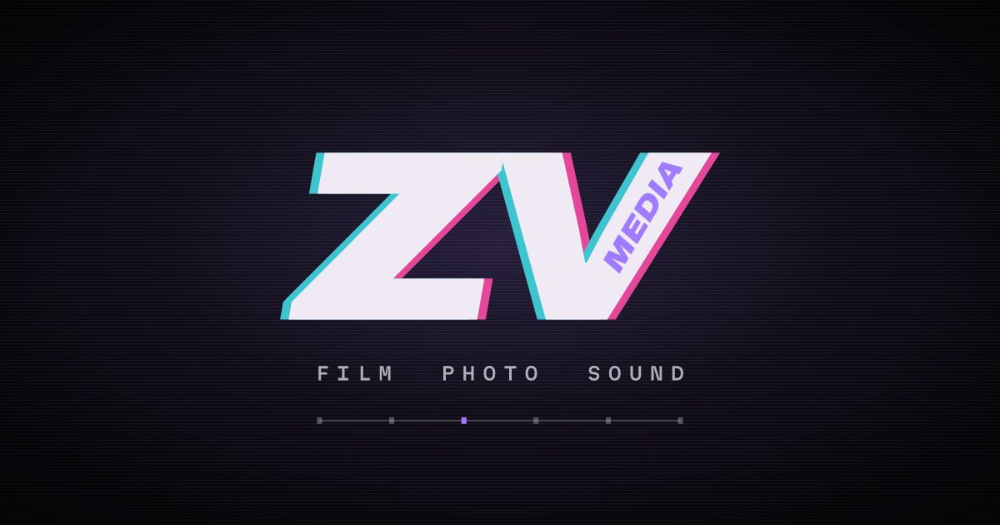
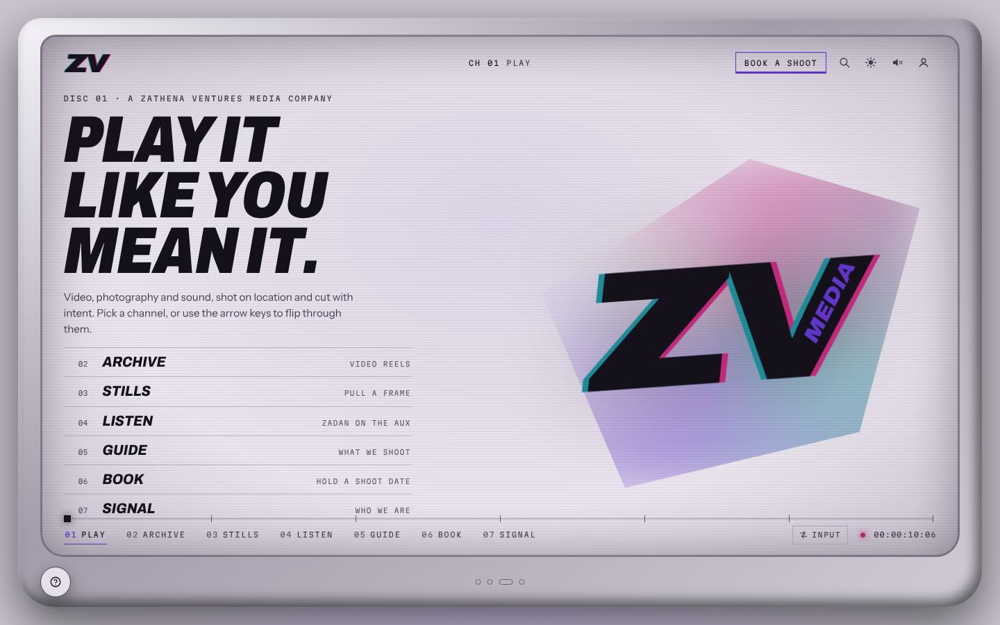
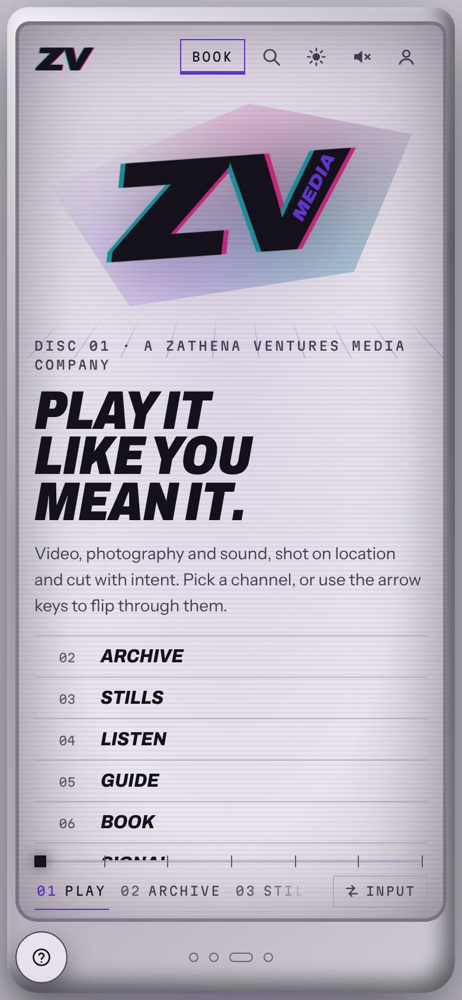

  

<h1 align="center"><a href="https://zvmedia.xyz">ZV Media</a></h1>

  ZV Media makes video, photography and sound. It started inside Zathena Ventures and now runs as its own brand, with its own site built like a television you tune rather than a page you scroll. Watch the reel, pull stills off the light table, listen to original tracks, then book a shoot against the live calendar.

  <strong>Live site:</strong> <a href="https://zvmedia.xyz">zvmedia.xyz</a>

  <a href="#what-it-is">What it is</a> · <a href="#services">Services</a> · <a href="#features">Features</a> · <a href="#book-or-get-in-touch">Book</a> · <a href="#connected-brands">Connected brands</a>

  
  
  

<table>
  <tr>
    <td align="center" valign="top"> Desktop: the set, with the screen and the channel rail.</td>
    <td align="center" valign="top"> Mobile: the same channels on a phone.</td>
  </tr>
</table>

## What it is

ZV Media is the film, video, photography and sound brand of the Zathena Ventures family. It split out of the studio to stand on its own, and it still makes the media for sister brands such as [MTV Weddings](https://mtvweddings.com).

The site works as a showroom and a booking desk at once. You tune in on arrival, flip between channels for the reel, the stills, the music and the dated signal entries, and book when you have seen enough.

## Services

All services are listed on the [services page](https://zvmedia.xyz/services/):

- **[Event coverage](https://zvmedia.xyz/services/event-coverage/)**
- **[Live sets and music videos](https://zvmedia.xyz/services/live-sets-and-music-videos/)**
- **[Brand and product](https://zvmedia.xyz/services/brand-and-product/)**
- **[Real estate and spaces](https://zvmedia.xyz/services/real-estate-and-spaces/)**
- **[Portraits and headshots](https://zvmedia.xyz/services/portraits-and-headshots/)**
- **[Podcast production](https://zvmedia.xyz/services/podcast-production/)**
- **[Music production](https://zvmedia.xyz/services/music-production/)**
- **[Video editing](https://zvmedia.xyz/services/video-editing/)**
- **[Photo editing](https://zvmedia.xyz/services/photo-editing/)**
- **[Writing](https://zvmedia.xyz/services/writing/)**

## Features

### The archive
- **[Reel archive](https://zvmedia.xyz/archive/)**: scrub the reel like tape, with silent previews.
- **[Stills table](https://zvmedia.xyz/stills/)**: a light table of photographs to pull from and shuffle.
- **[Listening room](https://zvmedia.xyz/listen/)**: original tracks with their production credits.
- **[Signal](https://zvmedia.xyz/signal/)**: dated transmissions and upcoming entries.

### The set
- **Entry gate**: a short tune-in sequence when you arrive.
- **Screen and channel rail**: one viewing surface, with channels to switch between.
- **Keyboard channel changes**: flip channels without reaching for the mouse.
- **Day and night viewing**: two picture modes.

### Booking and accounts
- **[Booking desk](https://zvmedia.xyz/book/)**: book a shoot against the live calendar.
- **Passwordless sign-in**: an emailed link, no password to remember.

### Accessibility
- **Reading controls**: text and reading options from the accessibility menu.
- **Colour-vision filters**: view the site through filters for different kinds of colour vision.
- **Help always in reach**: floating help and accessibility controls on every screen.

## Book or get in touch

[Book a shoot](https://zvmedia.xyz/book/) at the booking desk. For larger projects that also need a website or software, reach the studio through [Zathena Ventures](https://zathenaventures.xyz/contact).

## Connected brands

- **[Zathena Ventures](https://zathenaventures.xyz)**: the studio and central hub that ZV Media came from ([repo](https://github.com/ZATHENA-VENTURES/ZathenaVentures-Public)).
- **[ZV Labs](https://zvlabs.xyz)**: games, the other brand that split out of the studio.
- **[The Zathena Gallery](https://app.zathenaventures.xyz)**: the walkable 3D Zathena world, with a wing for ZV Media.
- **[MTV Weddings](https://mtvweddings.com)**: weddings in Fort Worth and DFW, whose media is made through ZV Media.

## License

© 2026 ZV Media. All rights reserved.

## Credits & Contact

- **Live site:** [zvmedia.xyz](https://zvmedia.xyz)
- **Book:** [zvmedia.xyz/book](https://zvmedia.xyz/book/)
- **Built and hosted by:** [Zathena Ventures](https://zathenaventures.xyz)

> This is the public showcase of a private repository. It presents the project, its features and its live site, and leaves out source code and deployment details.
